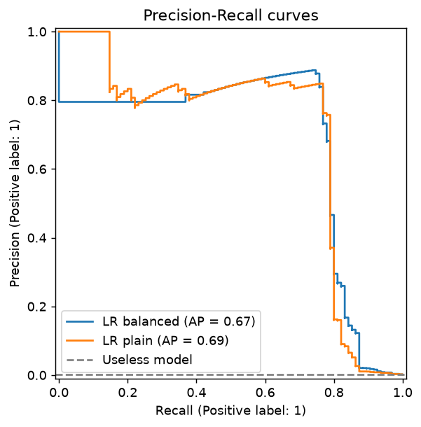
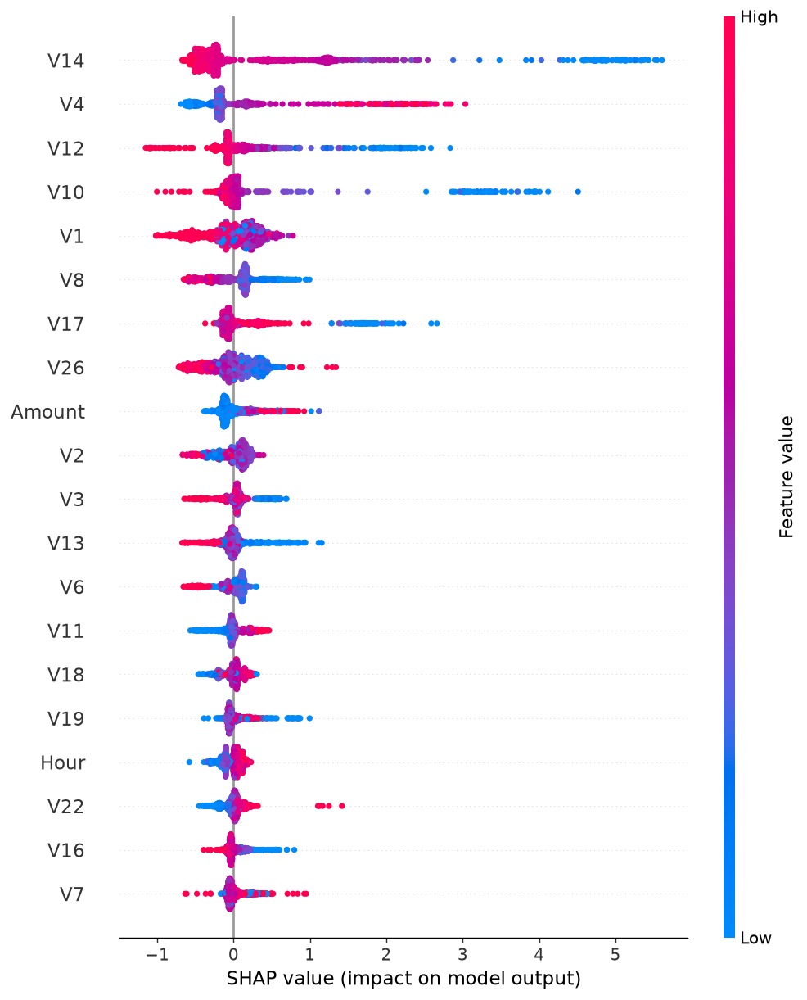

# FraudShield

Credit card fraud detection on highly imbalanced data: model comparison, cost-based threshold tuning, SHAP explainability, and a FastAPI endpoint.

## Problem

Only 0.17% of transactions are fraud. A model that always predicts "normal" reaches 99.8% accuracy and catches nothing, so accuracy is useless here. This project builds a classifier that is judged on the rare class, and turns it into an API that returns a fraud score and a decision.

## Dataset

[Credit Card Fraud Detection (Kaggle, ULB)](https://www.kaggle.com/datasets/mlg-ulb/creditcardfraud): 284,807 transactions from two days of European card activity, 492 frauds. Features `V1`-`V28` are anonymized PCA components; `Time` and `Amount` are raw.

- 1,081 duplicate rows removed (they could leak between train and test).
- Stratified 80/20 split: 226,980 train / 56,746 test, 0.167% fraud in both.
- The CSV is not in the repo. Download it to `data/raw/creditcard.csv`.

## Approach

| Step            | What I did                                                       | Why                                                                                           |
| --------------- | ---------------------------------------------------------------- | --------------------------------------------------------------------------------------------- |
| Metric          | PR-AUC, precision, recall (not accuracy, not ROC-AUC)            | With 0.17% fraud, ROC-AUC looked excellent (0.98) while precision of a baseline was only 6.6% |
| Validation      | Stratified 5-fold CV on the training set to compare models       | The test set has only 95 frauds, so a single score is noisy                                   |
| Leakage control | Scaling inside a `Pipeline`; duplicates removed before the split | Nothing is learned from the test data                                                         |
| Threshold       | Chosen on out-of-fold training predictions by minimizing cost    | The test set was used once, at the end                                                        |

## Results

**Model comparison** (5-fold CV PR-AUC on training data; differences under about 0.03 are within noise):

| Model                                      | PR-AUC            |
| ------------------------------------------ | ----------------- |
| Logistic Regression, class_weight=balanced | 0.754 ± 0.027     |
| Logistic Regression                        | 0.757 ± 0.030     |
| Random Forest                              | 0.835 ± 0.031     |
| XGBoost                                    | 0.842 ± 0.027     |
| **CatBoost**                               | **0.850 ± 0.030** |

**Things that did not help** (all within noise of plain CatBoost, 0.850):

| Experiment                                    | PR-AUC                |
| --------------------------------------------- | --------------------- |
| CatBoost + class weights                      | 0.834 ± 0.036         |
| CatBoost + SMOTE                              | 0.852 ± 0.038         |
| Ensemble (CatBoost + XGBoost + Random Forest) | 0.851 ± 0.030         |
| Without `Hour` feature                        | 0.849 ± 0.028         |
| Top 20 / 15 / 10 features                     | 0.850 / 0.838 / 0.827 |

Tree models beat Logistic Regression by about 0.09. After that, nothing moved the score, which suggests the limit comes from the data (anonymized features, no per-card history), not the model. I kept the simplest model.

**Final model on the held-out test set** (CatBoost, threshold 0.11):

| Metric                 | Value           |
| ---------------------- | --------------- |
| PR-AUC                 | 0.827           |
| ROC-AUC                | 0.983           |
| Precision              | 0.925           |
| Recall                 | 0.779           |
| Frauds caught / missed | 74 / 21 (of 95) |
| False alarms           | 6               |



## Threshold: choosing by cost, not 0.5

A missed fraud and a false alarm do not cost the same. I assumed **120 per missed fraud** (about the average fraud amount) and **5 per false alarm** (investigation time). On out-of-fold predictions, the best threshold was **0.11**, which cut the total cost from 9,455 to 7,395 compared with 0.5. The costs are assumptions: a different cost ratio gives a different threshold.

Cost on the test set with the same assumptions (only CatBoost had its threshold tuned):

| Strategy                            | Cost   |
| ----------------------------------- | ------ |
| Flag nothing                        | 11,400 |
| Logistic Regression (balanced) @0.5 | 8,520  |
| Logistic Regression @0.5            | 4,605  |
| XGBoost @0.5                        | 3,375  |
| CatBoost @0.11                      | 2,550  |

## Explainability

SHAP shows which features push a transaction toward fraud. Low `V14`, `V12` and `V10` and high `V4` are the strongest signals. Because `V1`-`V28` are anonymized, SHAP says which features matter but not what they mean in the real world.



## API

```bash
uvicorn fraudshield.api:app --reload
```

`POST /predict` takes `Time`, `Amount` and `V1`-`V28`, and returns:

```json
{ "fraud_probability": 0.9658, "is_fraud": true, "threshold": 0.11 }
```

Interactive docs at `http://127.0.0.1:8000/docs`. The `Hour` feature is derived from `Time` inside the prediction code, exactly as in training.

## Project structure

```
fraudshield/
├── data/raw/            # creditcard.csv (not tracked)
├── models/              # catboost_fraud.cbm, model_meta.json (threshold, feature order)
├── notebooks/           # EDA, baseline, model comparison, SHAP
├── reports/figures/     # plots used in this README
└── fraudshield/
    ├── load_data.py     # loading, cleaning, stratified split
    ├── evaluation.py    # metrics and model comparison helpers
    ├── predict.py       # loads the model and scores a transaction
    └── api.py           # FastAPI app
```

## Run it

```bash
git clone https://github.com/mohammedseghiralaa/fraudshield.git
cd fraudshield
python -m venv .venv
.venv\Scripts\activate        # Windows
pip install -r requirements.txt
pip install -e .
uvicorn fraudshield.api:app --reload
```

## Limitations

- Only 95 frauds in the test set: recall can move by several points from luck alone.
- The data covers two days of 2013 European transactions; fraud patterns change over time.
- The cost values are assumptions, and the threshold depends on them.
- No per-card history, so the model cannot use behavior over time.
- The API has no authentication, input logging or drift monitoring.
